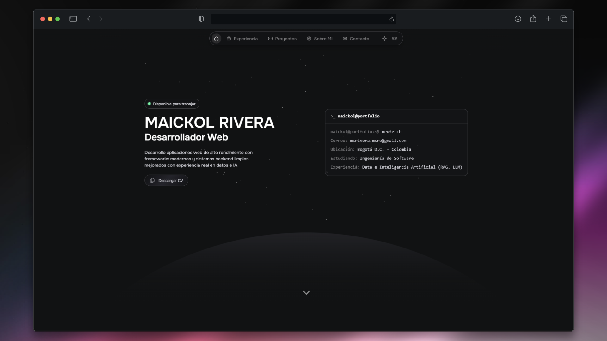

# Maickol Rivera

**Data Analyst & Junior Full Stack Developer** based in Bogotá, Colombia.  
Software Engineering student focused on process automation, data solutions, AI integrations, and web products built for production.

[**Portfolio**](https://maickolrivera.vercel.app) · [**Download CV**](https://maickolrivera.vercel.app/CV_MAICKOL_RIVERA.pdf)

---

## Experience

Current 
<b>Junior Full Stack Developer [Freelance]</b> 
Design, development, and deployment of web products, from requirements to production.

Mar 2026 – Sep 2026 
<b>Data Analyst [Open English] (Internship)</b> 
Built a RAG-based AI agent for team onboarding, integrated with Slack. Designed ETL pipelines that consolidate data from FTP, APIs, and Google Sheets, automated reporting, and built Looker Studio dashboards for KPIs and marketing funnels.

Oct 2025 – Dec 2025 
<b>Project Planner & Data Analyst [Proyecto EXPERTA]</b> 
Cleaned and consolidated characterization databases through ETL processes, analyzed results, and presented Power BI dashboards to adjust campaign decisions.

Mar 2025 – Sep 2025 
<b>Project Planner [Promise Gestión y Soluciones S.A.S]</b> 
Structured and followed up public investment projects in MGA-Web, aligned with the DNP methodology.

---

## Featured projects

| Project | Description | Links |
|---|---|---|
| **BigSort** | Visualize how sorting algorithms work, with step-by-step animations, live stats, and Big O notation. | [Live](https://bigsort.vercel.app/) · [Repo](https://github.com/maickolrivera/bigsort) |
| **Rekrypt** | Transform text by chaining 20+ hashing and encoding methods, with shareable chains. | [Live](https://rekrypt.vercel.app/) · [Repo](https://github.com/maickolrivera/rekrypt) |
| **Sistema Solar** | Interactive solar system simulation with elliptical orbits and planet rotation. | [Live](https://sistemasolar-threejs.vercel.app/) · [Repo](https://github.com/maickolrivera/sistema-solar) |

---

## Education

- **Software Engineering** — Fundación Universitaria Compensar · *In progress*
- **Software Application Programming Technician** — Fundación Universitaria Compensar · *2024 – 2026*
- **Certifications** from Cisco Networking Academy, Oracle Academy, and Microsoft Learn.
- **English:** B2

---

## Contact

- **Email:** [msrivera.msro@gmail.com](mailto:msrivera.msro@gmail.com)
- **LinkedIn:** [linkedin.com/in/maickol-rivera](https://www.linkedin.com/in/maickol-rivera/)
- **GitHub:** [github.com/maickolrivera](https://github.com/maickolrivera)

---

Built with ♥ by [Maickol Rivera](https://github.com/MaickolRivera)

